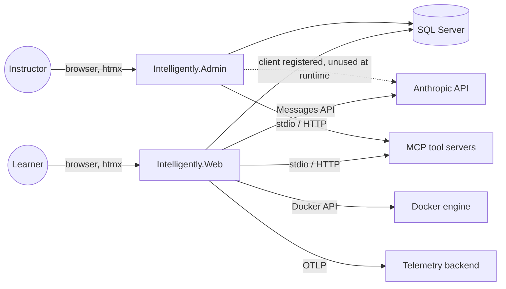
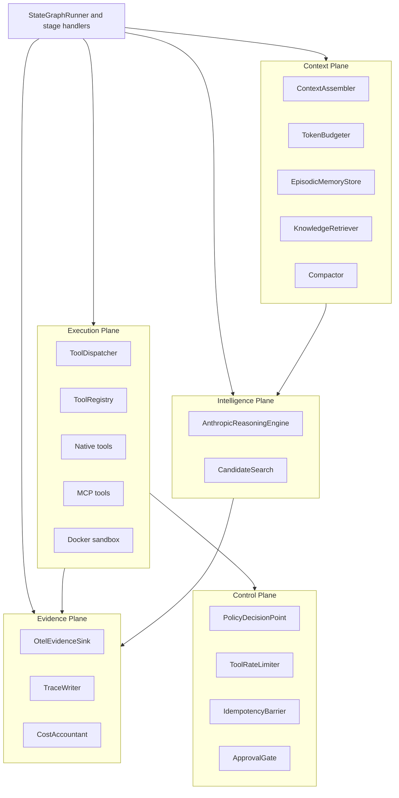
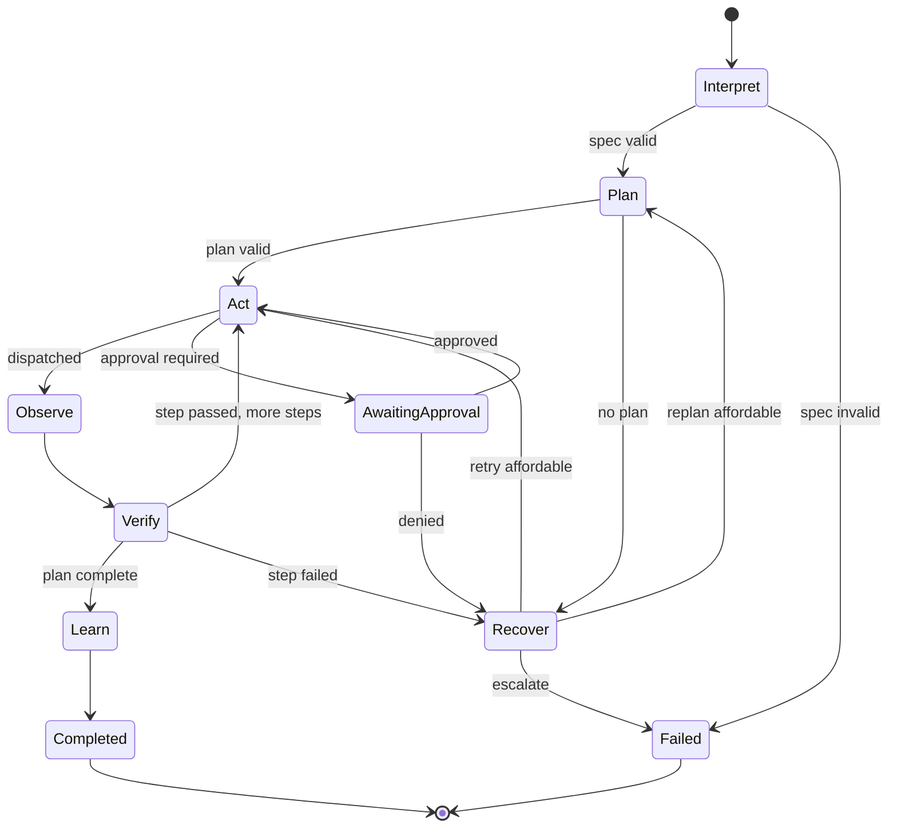
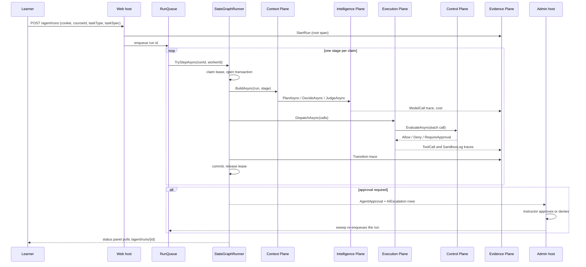
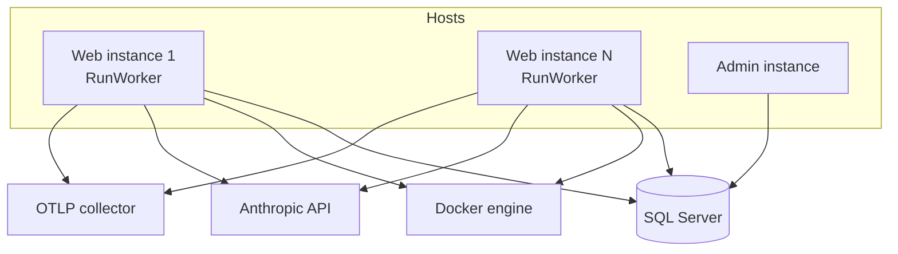

# Architecture

Intelligently is an ASP.NET Core 10 tutoring platform with an autonomous agent that diagnoses learner
problems, runs code in a sandbox, asks instructors for approval when it must, and feeds what it learns
back into a knowledge base. This document describes the system at the level of components, planes,
runtime flow, and deployment. The [Software Design](software-design.md) document goes one level down to
classes and pipelines; the [Database Design](database-design.md) document covers the schema; the
[User Guide](user-guide.md) covers setup and operation.

---

## 1. System context

Two web hosts share one database. **Web** serves learners, exposes the run API, and runs the only
background worker that executes agent runs. **Admin** serves instructors: it lists runs, shows the
evidence trail, and records approval and escalation decisions, but never executes a run. Both hosts use
ASP.NET Core Identity cookies against the shared database.

External dependencies are the Anthropic API for reasoning, a Docker engine for sandboxed code execution,
optional Model Context Protocol (MCP) servers for additional tools, and an optional OpenTelemetry
collector.

---

## 2. Solution structure

| Project | Role | Depends on |
|---|---|---|
| `Intelligently.Core` | Domain entities, plane interfaces, records, options, state graph definitions. No external packages | nothing |
| `Intelligently.Infrastructure` | EF Core data access, Identity, the Anthropic client wrapper, and every plane's implementation | Core |
| `Intelligently.Web` | Learner Razor Pages, the run API, the run worker, OpenTelemetry | Infrastructure |
| `Intelligently.Admin` | Instructor Razor Pages: approvals, runs, escalations | Infrastructure |
| `Intelligently.Tools` | Console account tool: create users, grant courses, manage the `Instructor` role | Infrastructure |
| `Intelligently.UnitTests` | The real runtime on SQLite in-memory with a mocked reasoning engine | Infrastructure |
| `Intelligently.IntegrationTests` | Both hosts under `WebApplicationFactory`, plus the evaluation harness | Web, Admin |

Core stays free of packages so that every plane can be replaced or faked without touching the domain.
Infrastructure is the only project that references the Anthropic SDK, the MCP SDK, Docker, Wasmtime,
JsonSchema.Net, and EF Core.

---

## 3. The five planes

The runtime separates responsibilities into five planes. Each plane has interfaces in Core and
implementations in a matching Infrastructure folder, and planes communicate only through those
interfaces.

| Plane | Responsibility | Boundary rule |
|---|---|---|
| **Intelligence** | Turn a prompt envelope into a plan, a tool decision, or a judgement, using Claude with structured outputs, strict tools, adaptive thinking, and optional test-time candidate search | Only place that calls the model for reasoning |
| **Context** | Assemble the envelope in a cache-stable order, retrieve knowledge and episodes, keep it under the token budget, request compaction, and persist episodic memory | Owns everything the model sees |
| **Execution** | Register tools, dispatch calls, run code in sandboxes, talk to MCP servers, validate outputs | Only place where side effects execute |
| **Control** | Decide whether each call may proceed: identity and enrolment, protected material, risk level, rate limits, idempotency, and human approval | Only place that decides permission; no tool runs without its verdict |
| **Evidence** | Record spans, metrics, append-only trace rows, and cost for every stage, model call, tool call, and sandbox run | Append-only; every other plane reports to it |

The state graph runner and its stage handlers sit above the planes and orchestrate them. Handlers call
the Context Plane to build an envelope, the Intelligence Plane to reason, the Execution Plane to act,
and the Evidence Plane to record, and the Execution Plane consults the Control Plane before anything
runs.

---

## 4. The seven-stage state graph

A run moves through explicit stages, and only the runner moves it. The transition table is the single
source of legal edges, and every recovery edge spends a budget counter that never refills, so every run
terminates.

| Stage | What happens | Model call |
|---|---|---|
| Interpret | Validate the task type, principal, and spec against the task contract; check the budget | none |
| Plan | Build the envelope, produce a plan as structured output (or the best of N candidates), validate and persist it | yes, high effort |
| Act | Resume a parked step or start a new attempt, ask the model for the next tool calls, spend tool-call budget, dispatch through the Control Plane | yes, medium effort |
| Observe | Truncate and store the results, record a note | none |
| Verify | Generic checks, then the task contract's deterministic gates, then a model judgement only when the contract defers | sometimes, high effort |
| Recover | Escalate on exhausted budget, oscillation, or a denied protected change; otherwise retry the step or replan | none |
| Learn | Compose the learner-facing explanation and fix, write the episode | none |

`AwaitingApproval` is a parked state: the run's status becomes `Waiting`, the worker drops it, and an
instructor's decision in Admin sets it back to `Running` for the next sweep to pick up.

The **recovery budget** has five counters: replans (3), retries (2), tool calls (40), tokens (300,000),
and wall clock (30 minutes). Recover escalates when the hard counters reach zero, when a plan hash
repeats within three revisions, or when a step fails twice with the same verifier message.

---

## 5. Runtime flow of one run

The important properties of this flow:

- **One stage per transaction.** Everything a stage writes, including rows written by exclusive tools,
  becomes visible together with the transition or not at all.
- **One worker per stage.** A conditional update claims the run with a lease before any work. Two
  concurrency tokens on the run make a stale worker's commit fail after a takeover.
- **Append-only history.** The transcript the model sees is replayed from stored response blocks, and
  evidence rows cannot be modified, so a run can be reconstructed exactly.
- **No side effect without a verdict.** The dispatcher asks the policy decision point about every call
  before any of them executes, and stops at the first that needs a human.

---

## 6. Identity and authorization

Both hosts use ASP.NET Core Identity with cookie authentication over the shared database. There is no
registration page; accounts are provisioned with the account tool (`src/Intelligently.Tools`).

- A **learner** is any authenticated user. Course enrolment is a set of `intelligently:course` claims,
  one per course id.
- An **instructor** holds the `Instructor` role, which the Admin agent pages require.
- The **run principal** (user id, roles, course scope) is built from the caller's claims only. Nothing in
  a request body contributes to it. It is stored on the run and every policy decision is made against it.

Browser requests that fail authorization are redirected to the login or access-denied page; JSON and
htmx requests receive a bare 401 or 403.

---

## 7. Data architecture

One SQL Server database holds three groups of tables: the Identity tables, the AI tutoring tables that
predate the agent (conversations, messages, escalations, knowledge entries, analytics events), and the
seven agent tables (runs, steps, plans, traces, episodes, approvals, idempotency records).

The agent tables cascade from the run. Links between agent tables and AI tables are soft references
without foreign keys, so an escalation can outlive its run and a knowledge entry can outlive its
escalation. `AgentTraces` is append-only, enforced in the DbContext. Runs carry a lease and two
concurrency tokens for multi-worker safety. The [Database Design](database-design.md) document has the
full schema.

Schema changes are EF Core migrations applied with the command-line tooling; neither host migrates at
startup.

---

## 8. Observability

Every run has a root span whose ids are stored on the run, so stage spans from any worker, in any
process, attach to the same trace. Stage, model-call, and tool-call spans carry the run, task, course,
user, stage, model, effort, token, cost, policy decision, and risk attributes. Metrics count tokens and
cost by model and stage, stage latency, cache activity, and repeated-prefix cache misses.

The database holds the same information in durable form. Each run's evidence rows include the exact
prompt envelope sent, the raw response, the provider's reasoning summary, tool payloads, sandbox output,
and per-call cost, and the Admin trace viewer renders them without any external telemetry backend.

Telemetry is configured in the Web host only: console exporters in Development, OTLP otherwise.

---

## 9. Deployment topology

- **Web** scales horizontally. Each instance has its own in-process queue and worker. A run is enqueued
  on the instance that created it; other instances pick it up only through the sweeps (startup, decided
  approvals, expired leases), and the lease prevents two instances from executing the same stage. HTTP
  and tool rate limits are per instance.
- **Admin** runs without a worker. It needs the same database, the Anthropic client registration, and
  Identity. Any configured MCP servers are also connected from Admin because the hosted service is part
  of the shared runtime registration.
- **Docker** must be reachable from every Web instance that executes lab runs. Containers run with no
  network, dropped capabilities, and memory, CPU, PID, and time limits.
- **Secrets** (connection string, API key) come from user secrets in Development and environment
  variables elsewhere.

---

## 10. Design principles

1. **Contracts are types.** One C# record defines a tool's input, its JSON schema, and its
   deserialization target; the same holds for structured outputs and task specs.
2. **Decisions and side effects are separate.** The Control Plane decides, the Execution Plane acts, and
   stage handlers do neither directly.
3. **Stable prefix first.** The envelope is assembled system prompt, then tools, then retrieved context,
   then transcript, then the volatile instruction, with cache breakpoints after the stable parts, and
   per-stage instructions travel as system-role messages inside the message list rather than in the
   top-level system field.
4. **Budgets only decrease.** Every recovery edge spends a counter, so no run loops forever.
5. **Evidence is append-only.** Corrections are new rows; history is replayed, never rewritten.
6. **Degrade without crashing.** A missing Docker engine, an unreachable MCP server, a token-counting
   failure, or a summarizer refusal each fall back to a safe default and the host keeps running.

---

## 11. Known limitations

- No code path has been exercised against the live Anthropic API; all phases were verified with a
  mocked reasoning engine on SQLite, and the migrations against SQL Server LocalDB.
- Model and effort are fixed per operation; there is no router that chooses by task class.
- A refusal from the model fails the run; no server-side fallback is configured.
- Approvals have no timeout.
- The WebAssembly sandbox is implemented but not reachable from any tool.
- Knowledge retrieval is full-text or `LIKE` with in-memory scoring; episodic recall is trigram
  similarity. No embeddings are computed.
- Queues and rate limits are per process.
