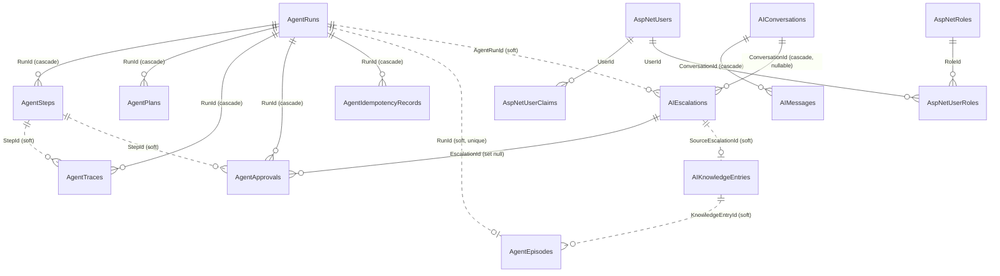

# Database Design

This document is the schema reference for Intelligently. It covers the three groups of tables in the
single SQL Server database, how they relate, the rules the code enforces on top of the schema, and how
the schema is applied and tested.

The authoritative model is the EF Core snapshot at
`src/Intelligently.Infrastructure/Data/Migrations/IntelligentlyDbContextModelSnapshot.cs`. Model
configuration lives in two files: `src/Intelligently.Infrastructure/Data/IntelligentlyDbContext.cs`
(the AI tables and the append-only guard) and `src/Intelligently.Infrastructure/Data/AgentModel.cs`
(the agent tables).

Related documents: [Architecture](architecture.md), [Software Design](software-design.md),
[User Guide](user-guide.md).

---

## 1. Overview

The database has 20 tables:

| Group | Tables | Purpose |
|---|---|---|
| ASP.NET Core Identity | 7 (`AspNetUsers`, `AspNetRoles`, `AspNetUserClaims`, `AspNetRoleClaims`, `AspNetUserLogins`, `AspNetUserRoles`, `AspNetUserTokens`) | Accounts, roles, and course-enrolment claims |
| AI tutoring | 5 (`AIConversations`, `AIMessages`, `AIEscalations`, `AIKnowledgeEntries`, `AIAnalyticsEvents`) | Chat sessions, instructor escalations, the knowledge base, analytics |
| Agent runtime | 7 (`AgentRuns`, `AgentSteps`, `AgentPlans`, `AgentTraces`, `AgentEpisodes`, `AgentApprovals`, `AgentIdempotencyRecords`) | The autonomous agent: runs, steps, plans, evidence, memory, approvals, idempotency |
| EF Core | 1 (`__EFMigrationsHistory`) | Applied migrations |

Design conventions that apply throughout:

- **User ids are plain strings.** No agent or AI table has a foreign key to `AspNetUsers`. Columns such
  as `UserId`, `Principal_UserId`, `DecidedBy`, `InstructorUserId`, and `AuthoredByUserId` hold the
  Identity user id as text.
- **Agent tables cascade from `AgentRuns`.** Deleting a run deletes its steps, plans, traces,
  approvals, and idempotency records.
- **Cross-group links are soft.** Links between the agent tables and the AI tables (for example
  `AIEscalations.AgentRunId` or `AgentEpisodes.KnowledgeEntryId`) are indexed columns without foreign
  key constraints, so either side can be removed without the other.
- **Enums are stored as strings.** `AgentStage` is stored as text in three tables. Status columns are
  string constants defined on the entity classes (section 5).
- **JSON lives in `nvarchar(max)` columns.** Four columns use EF value converters; the rest are strings
  that application code serializes. Section 6 lists the JSON shapes.
- **No check constraints, seed data, query filters, or rowversion columns.** Concurrency uses plain
  columns compared in the `UPDATE` statement's `WHERE` clause.

---

## 2. Entity relationship diagram



Solid lines are foreign keys. Dotted lines are soft references enforced only in code.

---

## 3. Agent runtime tables

### 3.1 AgentRuns

CLR type `Intelligently.Core.Agents.Entities.AgentRun`. One row per agent run: its position in the
state graph, status, recovery budget, principal, token and cost totals, lease, and learner-facing
output.

| Column | Type | Null | Notes |
|---|---|---|---|
| Id | uniqueidentifier | no | Primary key, generated client-side |
| UserId | nvarchar(450) | no | Learner who owns the run |
| CourseId | int | no | |
| TaskType | nvarchar(100) | no | For example `LabErrorDiagnosis` |
| TaskSpec | nvarchar(max) | no | JSON task specification, validated at Interpret |
| Stage | nvarchar(30) | no | `AgentStage` enum as text |
| Status | nvarchar(20) | no | `Running`, `Waiting`, `Completed`, `Failed`, `Cancelled` |
| StatusReason | nvarchar(max) | yes | Reason for the latest transition |
| PlanRevision | int | no | Current plan revision |
| CurrentStepIndex | int | no | Zero-based index into the current plan |
| RecoveryReason | nvarchar(30) | yes | Why the run last entered Recover; null after a successful Plan or Verify |
| Budget_ReplansLeft | int | no | Owned `RecoveryBudget` |
| Budget_RetriesLeft | int | no | Owned `RecoveryBudget` |
| Budget_ToolCallsLeft | int | no | Owned `RecoveryBudget` |
| Budget_TokensLeft | int | no | Owned `RecoveryBudget` |
| Budget_WallClockTicksLeft | bigint | no | Owned `RecoveryBudget.WallClockLeft`, a `TimeSpan` stored as ticks |
| Principal_UserId | nvarchar(450) | no | Owned `RunPrincipal` |
| Principal_RolesJson | nvarchar(max) | no | Owned `RunPrincipal.Roles` as a JSON array, for example `["Learner"]` |
| Principal_CourseScopeJson | nvarchar(max) | no | Owned `RunPrincipal.CourseScope` as a JSON array of course ids |
| TotalInputTokens | int | no | |
| TotalOutputTokens | int | no | |
| TotalCostUsd | decimal(12,6) | no | |
| CreatedAt | datetime2 | no | UTC |
| CompletedAt | datetime2 | yes | Set on a terminal transition |
| ConcurrencyStamp | uniqueidentifier | no | Concurrency token, regenerated on every commit |
| ClaimedBy | nvarchar(200) | yes | Lease holder, `{MachineName}/{ProcessId}` |
| ClaimedUntil | datetime2 | yes | Lease expiry in UTC. Also a concurrency token |
| TraceId | nvarchar(32) | yes | W3C trace id of the run's root span |
| RootSpanId | nvarchar(16) | yes | W3C span id of the run's root span |
| FinalExplanation | nvarchar(max) | yes | Learner-facing explanation written at completion |
| FixDiff | nvarchar(max) | yes | Unified diff of the learner's files |

Indexes: `IX_AgentRuns_Status_Stage` on (Status, Stage); `IX_AgentRuns_UserId_CreatedAt` on
(UserId, CreatedAt).

**Owned types.** `Budget` and `Principal` are EF owned types mapped into the same table with the
`Budget_` and `Principal_` prefixes. The budget counters only ever decrease; their starting values come
from the `Agents:Budgets` configuration section when a run is created. The principal is built from the
caller's claims only, never from a request body.

**Lease and concurrency.** A worker claims a run with one auto-committed conditional `UPDATE` that
matches only when the status is `Running` and `ClaimedUntil` is null or in the past. The stage then runs
inside a transaction. The commit regenerates `ConcurrencyStamp`, clears both lease columns, and
includes both tokens in the `WHERE` clause, so a worker whose lease was taken over cannot commit a stale
stage. Section 7 of the [Software Design](software-design.md) document describes the runner.

### 3.2 AgentSteps

CLR type `AgentStep`. One row per attempt at a plan step, covering one Act, Observe, Verify pass.

| Column | Type | Null | Notes |
|---|---|---|---|
| Id | uniqueidentifier | no | Primary key |
| RunId | uniqueidentifier | no | FK to `AgentRuns`, cascade |
| PlanRevision | int | no | Plan revision this step belongs to |
| PlanStepIndex | int | no | Index of the step within the plan |
| Attempt | int | no | One-based attempt number |
| Stage | nvarchar(30) | no | `AgentStage` as text |
| Status | nvarchar(20) | no | `Running`, `AwaitingApproval`, `Observed`, `Passed`, `Failed` |
| AssistantText | nvarchar(max) | yes | Text the model produced alongside its tool calls |
| ToolCallsJson | nvarchar(max) | yes | JSON array of `ToolCall` |
| ToolResultsJson | nvarchar(max) | yes | JSON array of `ToolResult`; `[]` when there were no calls |
| ResponseContentJson | nvarchar(max) | yes | Provider response content blocks, replayed verbatim on the next turn |
| PromptTokens | int | yes | Counted tokens of the prompt envelope |
| VerifierMessage | nvarchar(max) | yes | Outcome of the Verify stage |
| StartedAt | datetime2 | no | |
| CompletedAt | datetime2 | yes | |

Indexes: `IX_AgentSteps_RunId_PlanRevision_PlanStepIndex_Attempt`, unique.

### 3.3 AgentPlans

CLR type `AgentPlan`. One row per plan revision produced by the planner. The `goal` and `steps`
members form the structured-output contract the model fills; the remaining members are persistence
metadata.

| Column | Type | Null | Notes |
|---|---|---|---|
| Id | uniqueidentifier | no | Primary key |
| RunId | uniqueidentifier | no | FK to `AgentRuns`, cascade |
| Revision | int | no | |
| Hash | nvarchar(64) | no | SHA-256 hex of the serialized goal and steps, used for oscillation detection |
| CreatedAt | datetime2 | no | |
| Goal | nvarchar(max) | no | |
| StepsJson | nvarchar(max) | no | JSON array of plan steps (section 6) |
| ResponseContentJson | nvarchar(max) | yes | Planner response content blocks |

Indexes: `IX_AgentPlans_RunId_Revision` on (RunId, Revision), not unique.

### 3.4 AgentTraces

CLR type `AgentTrace`. The append-only evidence log. Every model call, tool call, sandbox run,
transition, approval, escalation, judgement, and candidate plan is one row.

| Column | Type | Null | Notes |
|---|---|---|---|
| Id | bigint | no | Primary key, identity |
| RunId | uniqueidentifier | no | FK to `AgentRuns`, cascade |
| StepId | uniqueidentifier | yes | Soft reference to `AgentSteps.Id` |
| Stage | nvarchar(30) | no | `AgentStage` as text |
| Kind | nvarchar(30) | no | See the kind list below |
| Payload | nvarchar(max) | no | JSON whose shape depends on `Kind` (section 6) |
| Model | nvarchar(100) | yes | Model id for model calls, judgements, and candidates |
| InputTokens | int | no | |
| OutputTokens | int | no | |
| CacheReadInputTokens | int | no | |
| CacheCreationInputTokens | int | no | |
| CostUsd | decimal(12,6) | no | Cost of this row's model call |
| ReasoningSummary | nvarchar(max) | yes | Provider reasoning summary when requested |
| StopReason | nvarchar(50) | yes | `end_turn`, `tool_use`, `max_tokens`, `refusal`, and so on |
| Effort | nvarchar(20) | yes | Effort level used for the call |
| LatencyMs | float | yes | Wall-clock latency of the call or stage |
| CreatedAt | datetime2 | no | |

Indexes: `IX_AgentTraces_RunId_CreatedAt` on (RunId, CreatedAt); `IX_AgentTraces_StepId_Kind` on
(StepId, Kind).

Kinds: `Transition`, `ModelCall`, `ToolCall`, `SandboxLog`, `Escalation`, `Approval`, `Note`,
`Judgement`, `Candidate`.

**Append-only rule.** The DbContext overrides `SaveChanges` and `SaveChangesAsync` and throws
`AppendOnlyViolationException` if any tracked `AgentTrace` is in the Modified or Deleted state. The rule
is enforced in code, not in the schema. It does not cover set-based updates or the cascade delete from
`AgentRuns`; no code path issues either against this table.

### 3.5 AgentEpisodes

CLR type `AgentEpisode`. Episodic memory: one row per finished run, written by the Learn stage, or by
the escalation resolver for runs that ended in escalation.

| Column | Type | Null | Notes |
|---|---|---|---|
| Id | uniqueidentifier | no | Primary key |
| RunId | uniqueidentifier | no | Soft reference to `AgentRuns.Id`; unique |
| UserId | nvarchar(450) | no | |
| CourseId | int | no | |
| TaskType | nvarchar(100) | no | |
| TaskText | nvarchar(max) | no | Task type plus every string and number in the spec, used for similarity |
| Outcome | nvarchar(20) | no | `Completed` or `Failed` |
| Summary | nvarchar(max) | no | Short summary, truncated to `Agents:Context:SummaryMaxChars` |
| ToolUsageJson | nvarchar(max) | no | JSON object of tool name to call count |
| EmbeddingJson | nvarchar(max) | yes | `float[]` as a JSON array. Reserved; nothing fills it yet |
| KnowledgeEntryId | int | yes | Soft reference to `AIKnowledgeEntries.Id` |
| CreatedAt | datetime2 | no | |

Indexes: `IX_AgentEpisodes_RunId`, unique; `IX_AgentEpisodes_UserId_TaskType_CreatedAt`;
`IX_AgentEpisodes_TaskType_CreatedAt`.

The episode writer returns the existing row for a run rather than inserting a second one, and the
unique index backs that guarantee.

### 3.6 AgentApprovals

CLR type `AgentApproval`. A human decision requested by the Control Plane for one tool call.

| Column | Type | Null | Notes |
|---|---|---|---|
| Id | uniqueidentifier | no | Primary key |
| RunId | uniqueidentifier | no | FK to `AgentRuns`, cascade |
| StepId | uniqueidentifier | no | Soft reference to `AgentSteps.Id` |
| ToolName | nvarchar(200) | no | |
| ToolCallJson | nvarchar(max) | no | The serialized `ToolCall` |
| ArgsHash | nvarchar(64) | no | SHA-256 hex of the canonical arguments; same key as the idempotency record |
| Reason | nvarchar(max) | no | Why approval was required |
| RuleKind | nvarchar(30) | yes | `PolicyRuleKind` name: `Identity`, `CourseMaterial`, `Risk`, `RateLimit`, `Idempotency` |
| Rule | nvarchar(100) | yes | Name of the policy rule that fired, for example `course-material-approval` |
| Status | nvarchar(20) | no | `Pending`, `Approved`, `Denied` |
| DecidedBy | nvarchar(450) | yes | Instructor user name |
| DecidedAt | datetime2 | yes | |
| DecisionNote | nvarchar(max) | yes | |
| EscalationId | int | yes | FK to `AIEscalations`, set null on delete |
| CreatedAt | datetime2 | no | |

Indexes: `IX_AgentApprovals_EscalationId`; `IX_AgentApprovals_RunId_CreatedAt`;
`IX_AgentApprovals_Status_CreatedAt`; `IX_AgentApprovals_RunId_ToolName_ArgsHash`, not unique.

Requesting an approval also inserts an `AIEscalations` row with medium priority so instructors see it in
the existing escalation flow. Deciding the approval marks that escalation resolved.

### 3.7 AgentIdempotencyRecords

CLR type `IdempotencyRecord`. One executed tool call per key. A replay with the same key returns the
stored result instead of executing the tool again.

| Column | Type | Null | Notes |
|---|---|---|---|
| Id | uniqueidentifier | no | Primary key |
| RunId | uniqueidentifier | no | FK to `AgentRuns`, cascade |
| ToolName | nvarchar(200) | no | |
| ArgsHash | nvarchar(64) | no | SHA-256 hex of the canonical arguments |
| ToolCallId | nvarchar(100) | no | Id of the first call that executed |
| ResultJson | nvarchar(max) | no | The serialized `ToolResult` |
| IsError | bit | no | Always false: failed results are not recorded |
| CreatedAt | datetime2 | no | |

Indexes: `IX_AgentIdempotencyRecords_RunId_ToolName_ArgsHash`, unique.

---

## 4. AI tutoring tables

These tables predate the agent runtime and are shared with the chat tutoring features. The agent
runtime writes to `AIEscalations`, `AIKnowledgeEntries`, and `AIAnalyticsEvents`.

### 4.1 AIConversations

| Column | Type | Null | Notes |
|---|---|---|---|
| Id | uniqueidentifier | no | Primary key |
| UserId | nvarchar(450) | no | |
| CourseId | int | no | |
| CurrentModuleId | int | yes | |
| Status | nvarchar(20) | no | Default `Active`; values `Active`, `Closed`, `Escalated` |
| SessionStartedAt | datetime2 | no | |
| SessionEndedAt | datetime2 | yes | |
| TotalTokensUsed | int | no | |
| MessageCount | int | no | |

Indexes: `IX_AIConversations_UserId_CourseId_Status`. Messages and escalations cascade on delete.

### 4.2 AIMessages

| Column | Type | Null | Notes |
|---|---|---|---|
| Id | bigint | no | Primary key, identity |
| ConversationId | uniqueidentifier | no | FK to `AIConversations`, cascade |
| Role | nvarchar(max) | no | `User`, `Assistant`, `System` |
| Content | nvarchar(max) | no | |
| InputTokens | int | yes | |
| OutputTokens | int | yes | |
| ModelUsed | nvarchar(max) | yes | |
| RetrievedChunkIds | nvarchar(max) | yes | JSON array |
| ConfidenceScore | decimal(5,4) | yes | |
| WasEscalated | bit | no | |
| SatisfactionRating | tinyint | yes | 1 for thumbs up, 0 for thumbs down |
| CreatedAt | datetime2 | no | |
| ReferencedModuleId | int | yes | |
| ReferencedVideoId | int | yes | |

Indexes: `IX_AIMessages_ConversationId_CreatedAt`.

### 4.3 AIEscalations

An instructor escalation raised either from chat or by an agent run. Exactly one of `ConversationId`
and `AgentRunId` is normally set.

| Column | Type | Null | Notes |
|---|---|---|---|
| Id | int | no | Primary key, identity |
| ConversationId | uniqueidentifier | yes | FK to `AIConversations`, cascade; null for agent runs |
| AgentRunId | uniqueidentifier | yes | Soft reference to `AgentRuns.Id`; null for chat |
| MessageId | bigint | yes | Soft reference to `AIMessages.Id` |
| UserId | nvarchar(max) | no | |
| CourseId | int | no | |
| ModuleId | int | yes | |
| LearnerQuestion | nvarchar(max) | no | For agent runs, the task spec truncated to 4000 characters |
| AIAttemptedResponse | nvarchar(max) | yes | |
| EscalationReason | nvarchar(max) | no | |
| Priority | nvarchar(450) | no | `High`, `Medium`, `Low` |
| Status | nvarchar(450) | no | `New`, `InProgress`, `Resolved`, `Closed`; code writes `New` and `Resolved` |
| InstructorResponse | nvarchar(max) | yes | |
| InstructorUserId | nvarchar(max) | yes | |
| AddToKnowledgeBase | bit | no | Set by the instructor to feed the answer into the knowledge base |
| CreatedAt | datetime2 | no | |
| ResolvedAt | datetime2 | yes | |
| NotifiedInstructorAt | datetime2 | yes | |
| LearnerNotifiedAt | datetime2 | yes | |

Indexes: `IX_AIEscalations_Status_Priority_CreatedAt`; `IX_AIEscalations_AgentRunId`;
`IX_AIEscalations_ConversationId`.

Agent write paths and their priorities: the approval gate writes Medium, the Recover stage writes High
when the budget is exhausted, and the `create_escalation` tool takes the priority from its input.

### 4.4 AIKnowledgeEntries

| Column | Type | Null | Notes |
|---|---|---|---|
| Id | int | no | Primary key, identity; key index of the full-text index |
| CourseId | int | yes | Null means the entry applies to every course |
| ModuleId | int | yes | |
| EntryType | nvarchar(max) | no | `FAQ`, `Misconception`, `LabError`, `Clarification`, `BestPractice` |
| Question | nvarchar(max) | no | Full-text column |
| Answer | nvarchar(max) | no | Full-text column |
| Tags | nvarchar(max) | yes | Full-text column; comma-separated |
| IsActive | bit | no | |
| AuthoredByUserId | nvarchar(max) | no | |
| SourceEscalationId | int | yes | Soft reference to `AIEscalations.Id`; one entry per escalation enforced in code |
| CreatedAt | datetime2 | no | |
| UpdatedAt | datetime2 | no | |
| IndexedAt | datetime2 | yes | |

Indexes: `IX_AIKnowledgeEntries_CourseId_IsActive`.

**Full-text index.** The Phase 3 migration creates the catalog `IntelligentlyKnowledgeCatalog` and a
full-text index on Question, Answer, and Tags, but only when the SQL Server instance reports full-text
as installed. The statements are guarded with existence checks and run outside the migration
transaction. The knowledge retriever checks at runtime whether the table has an active full-text index
and falls back to `LIKE` matching otherwise, so the feature works without full-text, only with coarser
matching.

### 4.5 AIAnalyticsEvents

| Column | Type | Null | Notes |
|---|---|---|---|
| Id | bigint | no | Primary key, identity |
| EventType | nvarchar(450) | no | See the list below |
| UserId | nvarchar(max) | no | |
| CourseId | int | no | |
| ConversationId | uniqueidentifier | yes | Soft reference |
| EscalationId | int | yes | Soft reference |
| Metadata | nvarchar(max) | yes | JSON |
| OccurredAt | datetime2 | no | |

Indexes: `IX_AIAnalyticsEvents_EventType_OccurredAt`.

Event types from the chat features: `MessageSent`, `EscalationTriggered`, `EscalationResolved`,
`FeedbackPositive`, `FeedbackNegative`, `SessionStarted`, `SessionClosed`. Event types the agent runtime
adds: `AgentRunFinished` (metadata carries run id, task type, status, stage, tokens, cost, and trace
id) and `LearnerNotified` (metadata carries run id, task type, channel, and message).

---

## 5. Identity tables

The context inherits from `IdentityDbContext` with the default `IdentityUser` and `IdentityRole` types,
so the seven tables are the standard ASP.NET Core Identity set with string keys. Two conventions matter
for this system:

- **Roles.** The `Instructor` role gates the Admin agent pages through the `InstructorPolicy`
  authorization policy. The `Learner` role is the default for run principals.
- **Course enrolment.** Enrolment is stored as user claims of type `intelligently:course`, one row in
  `AspNetUserClaims` per enrolled course id. The run principal's course scope is built from these claims
  and nothing else. This is a placeholder until a dedicated enrolment entity exists.

Accounts are provisioned out of band; there is no registration page. The [User Guide](user-guide.md)
explains how to create users, roles, and enrolment claims.

---

## 6. JSON column shapes

Columns with EF value converters:

| Column | CLR type | Shape |
|---|---|---|
| `AgentRuns.Principal_RolesJson` | `IReadOnlyList<string>` | `["Learner"]` |
| `AgentRuns.Principal_CourseScopeJson` | `IReadOnlyList<int>` | `[7, 9]` |
| `AgentPlans.StepsJson` | `IReadOnlyList<PlanStep>` | `[{"index":0,"description":"...","tool":"run_lab_code","success_criteria":"...","phase":"reproduce"}]` |
| `AgentEpisodes.EmbeddingJson` | `float[]` | `[0.12, -0.3, ...]` |

Columns application code serializes as strings:

| Column | Serialized type | Notes |
|---|---|---|
| `AgentRuns.TaskSpec` | Task contract record, for example `LabErrorDiagnosisSpec` | Validated against the task's JSON schema at Interpret |
| `AgentSteps.ToolCallsJson` | `List<ToolCall>` | `Id`, `Name`, `Input` |
| `AgentSteps.ToolResultsJson` | `List<ToolResult>` | `ToolCallId`, `Name`, `IsError`, `Content`, `ErrorKind`, `Payload`; Observe truncates `Content` |
| `AgentSteps.ResponseContentJson`, `AgentPlans.ResponseContentJson` | `List<JsonElement>` | Provider content blocks, replayed unchanged |
| `AgentEpisodes.ToolUsageJson` | `Dictionary<string,int>` | Tool name to call count, keys sorted |
| `AgentApprovals.ToolCallJson` | `ToolCall` | |
| `AgentIdempotencyRecords.ResultJson` | `ToolResult` | |
| `AIAnalyticsEvents.Metadata` | Anonymous object per event type | |

`AgentTraces.Payload` by kind:

| Kind | Payload fields |
|---|---|
| `Transition` | `from`, `to`, `reason`, `elapsedMs`, `status` |
| `ModelCall` | `envelope` (system, tool names, messages, prefix hash, prompt tokens, compaction), `response`, `content`, `reasoningSummary`, `stopReason`, `effort`, `latencyMs`, `costUsd` |
| `ToolCall` | `call`, `decision`, `decisionReason`, `rule`, `ruleKind`, `riskLevel`, `replayed`, `coalesced`, `exclusive`, `parallel`, `latencyMs`, `result` |
| `SandboxLog` | `call`, `sandbox`, `exitCode`, `stdout`, `stderr`, `timedOut`, `memoryExceeded`, `outputTruncated`, `durationSeconds`, `error` |
| `Escalation` | `reason`, `priority` |
| `Approval` | On request: `approvalId`, `status`, `tool`, `arguments`, `reason`, `ruleKind`, `rule`. On decision: `approvalId`, `status`, `tool`, `decidedBy`, `decidedAt`, `note`, `resumed` |
| `Note` | Observe: `stepIndex`, `attempt`, `results`, `errors`. Unhandled failure: `error`. Knowledge link: `escalationId`, `knowledgeEntryId`, `episodeId`, `resolvedBy`, `addedToKnowledgeBase` |
| `Judgement` | `stepIndex`, `phase`, `attempt`, `passed`, `score`, `minimumScore`, `rationale`, `rubric` |
| `Candidate` | `candidate`, `candidates`, `selected`, `succeeded`, `failureReason`, `judged`, `score`, `passed`, `rationale`, `goal`, `steps`, `planCostUsd`, `judgeCostUsd`, `totalCostUsd` |

Judgements and candidate plans are stored only as trace rows; there is no separate table for either.

---

## 7. Status and enum values

| Column | Values | Defined in |
|---|---|---|
| `AgentRuns.Stage`, `AgentSteps.Stage`, `AgentTraces.Stage` | `Interpret`, `Plan`, `Act`, `Observe`, `Verify`, `Recover`, `Learn`, `AwaitingApproval`, `Completed`, `Failed` | `src/Intelligently.Core/Agents/StateGraph/AgentStage.cs` |
| `AgentRuns.Status` | `Running`, `Waiting`, `Completed`, `Failed`, `Cancelled` (no code path sets `Cancelled` yet) | `AgentRun.cs` |
| `AgentRuns.RecoveryReason` | `PlanFailed`, `StepFailed`, `PolicyDenied`, `BudgetExhausted`, `MaterialDenied` | `src/Intelligently.Infrastructure/Agents/StateGraph/Handlers/RecoveryReasons.cs` |
| `AgentSteps.Status` | `Running`, `AwaitingApproval`, `Observed`, `Passed`, `Failed` | `AgentStep.cs` |
| `AgentTraces.Kind` | `Transition`, `ModelCall`, `ToolCall`, `SandboxLog`, `Escalation`, `Approval`, `Note`, `Judgement`, `Candidate` | `AgentTrace.cs` |
| `AgentApprovals.Status` | `Pending`, `Approved`, `Denied` | `AgentApproval.cs` |
| `AgentApprovals.RuleKind` | `Identity`, `CourseMaterial`, `Risk`, `RateLimit`, `Idempotency` | `src/Intelligently.Core/Agents/Contracts/PolicyRule.cs` |
| `AgentEpisodes.Outcome` | `Completed`, `Failed` | `AgentRun.cs` constants |
| `AIEscalations.Status` | `New`, `InProgress`, `Resolved`, `Closed` | `AIEscalation.cs` |
| `AIEscalations.Priority` | `High`, `Medium`, `Low` | `AIEscalation.cs` |
| `AIConversations.Status` | `Active`, `Closed`, `Escalated` | `AIConversation.cs` |

The run's status is derived from its stage on every transition: `Completed` and `Failed` map to the
same status, `AwaitingApproval` maps to `Waiting`, and everything else maps to `Running`.

---

## 8. Migrations

Migrations live in `src/Intelligently.Infrastructure/Data/Migrations` and are applied only through the
EF Core tooling. Neither host calls `Migrate` or `EnsureCreated` at startup.

| Order | Migration | What it does |
|---|---|---|
| 1 | `InitialSchema` | Identity tables, the five AI tables, and the Phase 1 agent tables (`AgentRuns`, `AgentSteps`, `AgentPlans`, `AgentTraces`, `AgentEpisodes`) |
| 2 | `Phase2ControlPlane` | Owned `Principal_*` columns on `AgentRuns` with a T-SQL backfill from `UserId` and `CourseId`; `AgentApprovals` and `AgentIdempotencyRecords` |
| 3 | `Phase3ContextPlane` | `PromptTokens` and `ResponseContentJson` on steps and plans; `TaskText` and `EmbeddingJson` on episodes; the guarded full-text catalog and index |
| 4 | `AddRunLease` | `ClaimedBy` and `ClaimedUntil` on `AgentRuns` |
| 5 | `Phase5EvidencePlane` | `CostUsd`, `Effort`, `LatencyMs`, `ReasoningSummary`, `StopReason` on traces; `TraceId` and `RootSpanId` on runs |
| 6 | `Phase6LabErrorDiagnosis` | `FinalExplanation` and `FixDiff` on runs; `Rule` and `RuleKind` on approvals |

Create a migration:

```bash
dotnet ef migrations add <Name> --project src/Intelligently.Infrastructure --startup-project src/Intelligently.Infrastructure --output-dir Data/Migrations
```

Apply migrations:

```bash
dotnet ef database update --project src/Intelligently.Infrastructure --startup-project src/Intelligently.Infrastructure
```

A design-time factory in `src/Intelligently.Infrastructure/Data/DesignTimeDbContextFactory.cs` supplies
the context to the tooling. It reads the connection string from the `ConnectionStrings__DefaultConnection`
environment variable and falls back to LocalDB (`(localdb)\MSSQLLocalDB`, database `Intelligently`).

All six migrations were applied in order to a LocalDB instance with no errors, and the idempotent script
generates without warnings. See `verification-sql-server-and-live-api.md`. LocalDB does not have
full-text search installed, so the full-text branch of the Phase 3 migration has not yet executed on any
server.

---

## 9. Test databases and provider differences

Tests never run the migrations. They build the schema from the model with `EnsureCreated` on SQLite
in-memory databases:

- Unit tests share one open in-memory connection per test host.
- Integration tests use a named shared-cache in-memory database per host, kept alive by one connection.

Because of this, the Phase 2 T-SQL backfill and the Phase 3 full-text DDL are exercised only on SQL
Server.

The code handles three provider differences explicitly:

- **Knowledge search.** On SQL Server with an active full-text index the retriever uses `FREETEXT`.
  Everywhere else it builds an escaped `LIKE` filter. Both paths score candidates in memory.
- **Episode similarity.** Trigram similarity is computed in memory so the same query works on both
  providers.
- **Transactions.** Each stage runs in a transaction opened after the lease claim. On SQLite a stage
  transaction takes a write lock on the single test connection, so the lease takeover test sets the
  lease directly instead of racing two workers.
